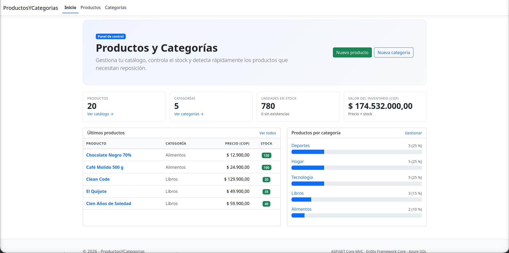
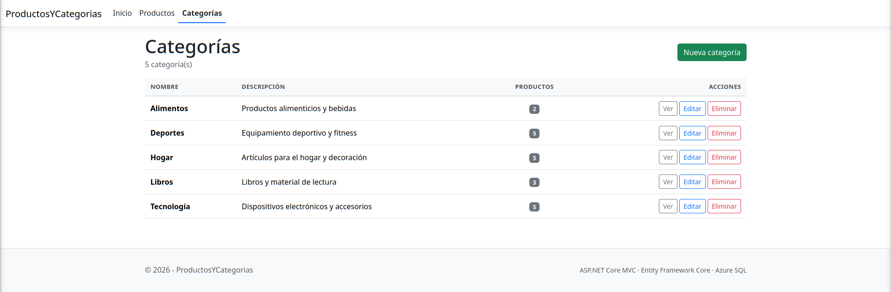
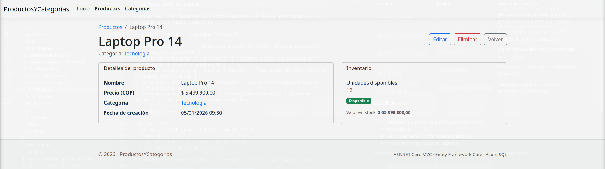
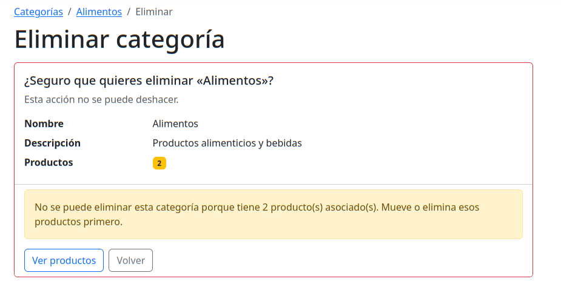
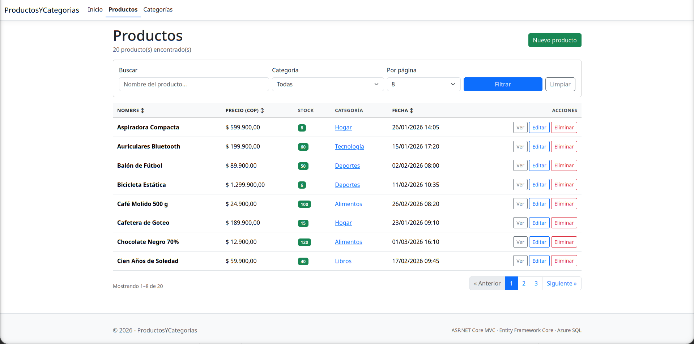
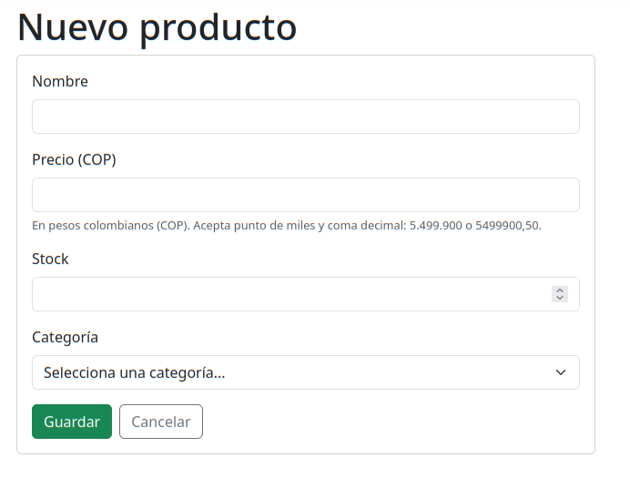
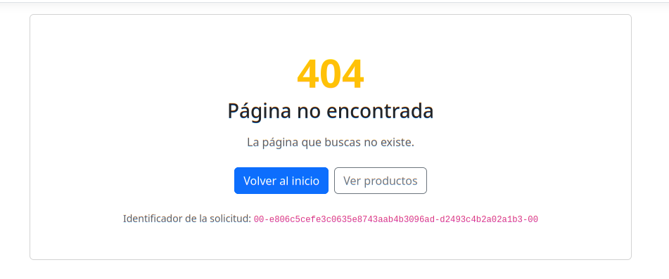

# Productos y Categorias

Aplicación web ASP.NET Core MVC para administrar un catálogo de productos y categorías. Incluye un panel con métricas del inventario, CRUD completo, búsqueda, filtros, ordenación y paginación. Usa Entity Framework Core Code-First sobre SQL Server/Azure SQL y se despliega en Azure App Service con GitHub Actions.

Los precios se manejan en pesos colombianos (COP) y la interfaz usa la cultura `es-CO`.



## Características

- Panel de inicio con total de productos, categorías, unidades en stock y valor del inventario.
- Últimos cinco productos y distribución de productos por categoría.
- Alerta de reposición para productos con stock menor que 5, incluidos los que están en cero.
- CRUD de categorías con nombre único y descripción opcional.
- CRUD de productos con precio, stock, categoría y fecha de creación.
- Búsqueda por nombre y filtro por categoría.
- Ordenación por nombre, precio o fecha, ascendente y descendente.
- Paginación en servidor con tamaños de 4, 8, 12 y 24; 8 por defecto.
- Validación en cliente y servidor. El precio acepta punto de miles y coma decimal: `5.499.900`, `5499900` o `5499900,50`.
- Borrado de categoría bloqueado si tiene productos asociados.
- Páginas de error 404 y 500 en español.

## Tecnologías

| Tecnología | Versión | Uso |
|---|---|---|
| .NET | 10 (LTS) | Runtime y SDK |
| ASP.NET Core MVC | 10 | Controladores, vistas y enrutamiento |
| Razor | 10 | Plantillas de las vistas |
| Entity Framework Core | 10.0.14 | ORM Code-First y migraciones |
| SQL Server / Azure SQL | — | Base de datos |
| Bootstrap | 5 | Estilos y componentes |
| jQuery Validation | — | Validación en el navegador |
| GitHub Actions | — | Integración y despliegue continuo |
| Azure App Service | Linux, .NET 10 | Hosting |

La versión del SDK está fijada en `global.json` (`10.0.100`, con `rollForward: latestFeature`).

## Estructura del proyecto

```text
Controllers/            Controladores de Home, Products y Categories
Data/                   DbContext, fábrica de diseño y migraciones
  Migrations/
Models/                 Entidades y DTO de paginación
  ViewModels/           Modelos de las vistas de inicio y listado
Views/                  Vistas Razor
  Categories/
  Products/
  Home/
  Shared/               Layout, alertas, paginación y página de error
Infrastructure/
  Formatting/           Conversión de fechas UTC a hora de Colombia
  ModelBinding/         Binder decimal flexible
wwwroot/                Bootstrap, jQuery, CSS y JavaScript propios
.github/workflows/      Pipeline de compilación, migraciones y despliegue
```

El flujo es `Controlador → SampleDbContext → SQL Server`. Los controladores usan EF Core directamente; no hay capa de repositorio ni de servicios.

## Modelo de datos

### Category

| Campo | Tipo | Restricciones |
|---|---|---|
| `Id` | `int` | PK, identity |
| `Name` | `nvarchar(100)` | Obligatorio, único (`UX_Categories_Name`) |
| `Description` | `nvarchar(500)` | Opcional |

### Product

| Campo | Tipo | Restricciones |
|---|---|---|
| `Id` | `int` | PK, identity |
| `Name` | `nvarchar(100)` | Obligatorio, indexado (`IX_Products_Name`) |
| `Price` | `decimal(18,2)` | Mayor que cero, en COP |
| `Stock` | `int` | Mayor o igual que cero |
| `CategoryId` | `int` | FK a `Categories`, indexado (`IX_Products_CategoryId`) |
| `FechaCreacion` | `datetime2` | UTC, valor por defecto `SYSUTCDATETIME()` |

Relación: una categoría tiene muchos productos (`1:N`). La clave foránea usa `DeleteBehavior.Restrict`, por lo que una categoría con productos no se puede eliminar.

Los datos semilla incluyen 5 categorías y 20 productos de demostración con precios en COP. Son deterministas para que las migraciones sean reproducibles.

## Requisitos locales

- SDK de .NET 10.
- SQL Server 2019 o superior, o una base de datos de Azure SQL.
- Git.
- Herramientas locales de EF Core: se restauran con `dotnet tool restore`.

Para desplegar: cuenta de Azure con App Service y Azure SQL, y un repositorio en GitHub con Actions habilitado.

## Puesta en marcha local

1. Clona el repositorio:

```bash
git clone https://github.com/thetrueseros/ProductosYCategorias.git
cd ProductosYCategorias
```

2. Restaura las herramientas de EF Core:

```bash
dotnet tool restore
```

3. Crea la configuración local a partir de la plantilla:

```bash
cp appsettings.Development.example.json appsettings.Development.json
```

En Windows usa `copy` en lugar de `cp`. Edita `appsettings.Development.json` y reemplaza los valores de `DefaultConnection`. Ese archivo está en `.gitignore` y no debe versionarse.

4. Aplica las migraciones. Esto crea la base de datos si no existe y carga los datos de demostración:

```bash
dotnet ef database update
```

5. Inicia la aplicación:

```bash
dotnet run
```

La aplicación queda disponible en `http://localhost:5072`. Para usar HTTPS, inicia con `dotnet run --launch-profile https` y abre `https://localhost:7197`.

> Ejecuta los comandos desde la raíz del repositorio. La fábrica de diseño de EF Core lee `appsettings.Development.json` desde el directorio actual.

Si falta la cadena de conexión, la aplicación se detiene al arrancar con un mensaje que indica qué variable configurar.

## Uso

### Dashboard

La página de inicio resume el estado del inventario:

- Total de productos y de categorías.
- Unidades en stock y productos sin existencias.
- Valor del inventario, calculado como precio por stock.
- Últimos cinco productos creados.
- Porcentaje de productos por categoría.
- Alerta cuando hay productos con stock menor que 5.

### Categorías

`/Categories` muestra el nombre, la descripción y el número de productos de cada categoría. Desde allí se puede ver el detalle, editar o eliminar.

- El nombre es obligatorio, único y de máximo 100 caracteres; la descripción admite hasta 500.
- Si se intenta crear o renombrar una categoría con un nombre existente, se muestra un error.
- El detalle lista los productos de la categoría y permite añadir uno nuevo.
- La eliminación se bloquea si la categoría tiene productos. El aviso indica cuántos productos la usan.







### Productos

`/Products` muestra el catálogo paginado. Cada fila incluye nombre, precio en COP, stock, categoría y fecha de creación; el stock se resalta en rojo cuando es cero y en amarillo cuando es menor que 5.



Filtros y parámetros del listado:

| Parámetro | Valores | Por defecto |
|---|---|---|
| `search` | Texto contenido en el nombre | Vacío |
| `categoryId` | Id de categoría | Todas |
| `sortOrder` | `name`, `name_desc`, `price`, `price_desc`, `date`, `date_desc` | `name` |
| `page` | Número de página | `1` |
| `pageSize` | `4`, `8`, `12`, `24` | `8` |

El formulario de alta y edición valida nombre, precio, stock y categoría. El precio se escribe en pesos colombianos y acepta separadores de miles con punto y decimales con coma.



La fecha de creación se guarda en UTC y se muestra en la hora de Colombia (`America/Bogota`).

### Errores

Las rutas inexistentes y los errores internos usan una página propia. El código 404 muestra “Página no encontrada”; el resto muestra “Algo ha ido mal” e incluye el identificador de la solicitud para revisar los logs.



### Rutas

| Método | Ruta | Acción |
|---|---|---|
| GET | `/` | Dashboard |
| GET | `/Products` | Listado con filtros y paginación |
| GET | `/Products/Details/{id}` | Detalle del producto |
| GET | `/Products/Create` | Formulario de alta |
| POST | `/Products/Create` | Guardar producto |
| GET | `/Products/Edit/{id}` | Formulario de edición |
| POST | `/Products/Edit/{id}` | Guardar cambios |
| GET | `/Products/Delete/{id}` | Confirmación de baja |
| POST | `/Products/Delete/{id}` | Eliminar producto |
| GET | `/Categories` | Listado de categorías |
| GET | `/Categories/Details/{id}` | Detalle con sus productos |
| GET | `/Categories/Create` | Formulario de alta |
| POST | `/Categories/Create` | Guardar categoría |
| GET | `/Categories/Edit/{id}` | Formulario de edición |
| POST | `/Categories/Edit/{id}` | Guardar cambios |
| GET | `/Categories/Delete/{id}` | Confirmación de baja |
| POST | `/Categories/Delete/{id}` | Eliminar categoría, si no tiene productos |
| GET | `/Home/Error?statusCode={code}` | Página de error |

## Decisiones de diseño

- EF Core se usa directamente en los controladores; no hay repositorio ni unidad de trabajo.
- El filtrado, la ordenación y la paginación se resuelven en SQL, no en memoria.
- `DeleteBehavior.Restrict` y la comprobación en el controlador impiden borrar categorías con productos.
- La cultura es `es-CO` y los precios se muestran en COP. El binder decimal acepta coma, punto y separadores de miles.
- Las fechas se almacenan en UTC y se convierten a `America/Bogota` al mostrarlas.
- Las migraciones se aplican en el pipeline; la aplicación no llama a `Database.Migrate()` al arrancar.

## Despliegue en Azure

### Recursos

- App Service en Linux con runtime .NET 10.
- Azure SQL Database.
- Un grupo de recursos que contenga ambos.

### Configuración del App Service

- Cadena de conexión `DefaultConnection` de tipo SQLAzure, con el usuario y la contraseña de la base.
- Regla de firewall del servidor SQL que permita los servicios y recursos de Azure.
- Variables de aplicación:
  - `ASPNETCORE_FORWARDEDHEADERS_ENABLED=true`
  - `SCM_DO_BUILD_DURING_DEPLOYMENT=false`

### GitHub Actions

El workflow está en `.github/workflows/azure-deploy.yml`. Se ejecuta al hacer push a `main` y también manualmente con `workflow_dispatch`.

Jobs:

1. `build`: restaura, compila en Release y publica el artefacto.
2. `migrate`: aplica `dotnet ef database update` contra Azure SQL.
3. `deploy`: inicia sesión con OIDC, ajusta el runtime a `DOTNETCORE|10.0`, despliega y ejecuta un smoke test contra `/` y `/Products`.

Secretos del repositorio:

| Secreto | Uso |
|---|---|
| `AZURE_CLIENT_ID` | App registration de Entra ID |
| `AZURE_TENANT_ID` | Tenant de Azure |
| `AZURE_SUBSCRIPTION_ID` | Suscripción |
| `AZURE_SQL_CONNECTION_STRING` | Migraciones contra Azure SQL |

La credencial federada debe apuntar a `repo:thetrueseros/ProductosYCategorias:ref:refs/heads/main` y el registro de aplicaciones necesita el rol `Website Contributor` sobre el App Service o su grupo de recursos.

El flujo de despliegue es:

```text
push a main → build → migrate → deploy → smoke test
```

La aplicación queda en `https://<nombre-del-app-service>.azurewebsites.net`.

## Verificación

- El dashboard responde y muestra los valores en COP.
- Se puede crear, editar y eliminar una categoría.
- Un nombre de categoría duplicado se rechaza.
- Se puede crear un producto con precio `5.499.900` y aparece con el formato `$ 5.499.900,00`.
- Eliminar una categoría con productos muestra el aviso y no borra nada.
- La búsqueda, el filtro por categoría, el orden y la paginación conservan los parámetros.
- Una ruta inexistente devuelve 404 con la página personalizada.
- En Azure, el smoke test del workflow termina correctamente.

## Solución de problemas

| Síntoma | Causa probable | Solución |
|---|---|---|
| La app no arranca y pide `DefaultConnection` | Falta la cadena de conexión | Configura `appsettings.Development.json` o `ConnectionStrings__DefaultConnection` |
| Error de conexión a Azure SQL | Firewall o credenciales | Revisa la regla “Permitir servicios de Azure” y la cadena |
| `NETSDK1226` al restaurar | Falta el targeting pack de ASP.NET Core 10 | El proyecto ya define `AllowMissingPrunePackageData`; si persiste, instala el targeting pack |
| `dotnet ef` no se reconoce | Herramientas locales sin restaurar | `dotnet tool restore` |
| Error 500 después del despliegue | Conexión, migraciones o configuración | Revisa el log del App Service y el job `migrate` |

## Contexto académico

Proyecto de desarrollo web con ASP.NET Core MVC y Entity Framework Core. El objetivo es implementar un CRUD completo con relaciones, validación, filtros, paginación, datos de demostración y un despliegue automatizado en Azure.

Repositorio: [thetrueseros/ProductosYCategorias](https://github.com/thetrueseros/ProductosYCategorias)
